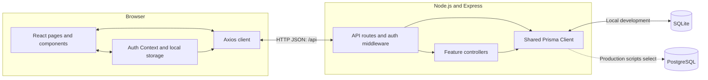

# TrueNarrative.io

TrueNarrative.io is a full-stack product feedback application. Product owners create shareable feedback boards where people can submit ideas, vote, and discuss suggestions. It brings feedback together around a product and makes community responses visible.

The repository also serves as a teaching application: developers can follow a feature from a React component through an Express API to a relational database, then extend it through hands-on exercises.

## Project overview

Implemented capabilities include:

- **Product management:** authenticated users can create products, edit or delete their own products, and copy a public feedback link based on a generated UUID.
- **Ideas and discussion:** visitors can submit ideas without an account, open an idea detail page, and add comments. Signed-in contributions are associated with a user; guest comments include a display name and browser-generated identifier.
- **Voting:** signed-in users and identified guests can vote up or down. Repeating the same vote returns a conflict; choosing the opposite direction updates the existing vote.
- **Feedback browsing:** boards display vote and comment counts and filter ideas by status in the browser.
- **Administration:** an admin-only dashboard displays totals, recent activity, status and vote breakdowns, and top contributors, products, and ideas.

Some workflows are incomplete. Registration exists in the API, but its browser route is commented out; `/login` works when opened directly, while the navigation link is hidden. Ideas default to `New`, and the UI filters `New`, `Done`, and `Retired`, but there is no API or UI for changing status. The `MODERATOR` role exists in the schema without a dedicated moderation workflow. See [architecture and known limitations](docs/architecture.md) for details.

## Technology stack

| Area | Technologies in the repository |
| --- | --- |
| Frontend | React 19, React Router 7, Vite 6, Tailwind CSS 3, Axios, Lucide icons, React Hot Toast |
| Backend | Node.js, Express 5, JavaScript ES modules |
| Database | Prisma Client 6; SQLite for local development; PostgreSQL migration files and a production provider-switch script |
| Authentication | Email/password login, bcrypt password hashing, JSON Web Tokens, React Context and browser local storage |
| Development tooling | Independent npm packages with their own lockfiles, Concurrently, Vite dev proxy, Vitest |

PostgreSQL-related scripts are present; this repository does not include a complete, verified hosting configuration.

## Architecture



The frontend and backend run as separate development services. Vite serves the browser application and proxies `/api` requests to the backend, so the browser sees a single origin in development; a production build can instead call a separate API origin set in `VITE_API_URL`. Express mounts feature routers under `/api`, applies authentication where required, and delegates database operations to controllers using Prisma. Authentication middleware also queries the database to load the current user.

Feature folders organize React components around authentication, products, ideas, and administration. React Context owns authentication state, while components hold their own fetched data and form state. On the server, routes, middleware, controllers, and utilities have separate responsibilities; controllers query Prisma directly rather than using a separate service layer.

The [architecture guide](docs/architecture.md) covers routes, database relationships, authentication, deployment scripts, and engineering tradeoffs.

## Key engineering concepts

1. **Public identifiers and ownership checks.** Products have numeric database IDs and UUIDs for public URLs. Product update and deletion handlers check the authenticated user's ID against `ownerId`; knowing a share link does not confer edit permission.
2. **Authenticated and guest participation.** Optional authentication middleware lets the same idea, comment, and voting endpoints accept signed-in and anonymous contributions. Guest identifiers support browser-level vote tracking, not verified identity or abuse prevention.
3. **Relational constraints.** Users, products, ideas, votes, and comments are modeled explicitly with foreign keys and cascading deletes. Composite unique constraints on votes enforce one record per idea/user or idea/guest identifier.
4. **API responses shaped for the UI.** Idea list responses derive upvote, downvote, and comment counts. The admin controller combines counts, grouped queries, and relation counts to populate its dashboard.
5. **Lightweight client state.** Auth Context restores the stored session, Axios interceptors attach bearer tokens, and feature components update local state after mutations. This keeps the data flow visible for learners, while exposing tradeoffs around session handling and consistency.

## Getting started

Use **Node.js 22 or newer**, npm, and Git. SQLite runs locally without a separate database server.

```bash
git clone https://github.com/agiletodd/TrueNarrative.io.git
cd TrueNarrative.io
npm run setup
```

`setup` runs `npm ci` for the root scripts, the backend, and the frontend. They are independent npm packages, each with its own lockfile, matching how they are deployed. The Prisma CLI is a pinned backend dependency (6.10.0, the same version as Prisma Client), so nothing is downloaded at runtime.

Copy [backend/.env.example](backend/.env.example) to `backend/.env` and replace the `JWT_SECRET` placeholder with a generated value; the backend refuses to start without a valid secret. The frontend needs no settings file in development. The [student setup guide](docs/student-setup.md) includes copy commands and secret generation.

```bash
npm run db:setup   # creates backend/prisma/dev.db and generates Prisma Client
npm run dev        # starts the API on :4000 and the frontend on Vite's port
```

Open the frontend URL that Vite prints (normally <http://localhost:5173>). Vite forwards `/api` to the backend, so the frontend works on whichever port Vite picks. The API health check is at <http://localhost:4000/health>; it reports the HTTP server only and does not check the database. In development, the backend restarts automatically when its files change.

**First account:** the browser registration route is disabled. Follow [the account setup and walkthrough](docs/student-setup.md#5-create-an-account-and-verify-the-application) to register through the API, then open `/login` directly and create a product. New databases have no sample users or products; the seed file is empty.

For classroom participation, fork the repository and clone your fork as described in the [complete pre-class guide](docs/student-setup.md).

### Tests and frontend build

From the root:

```bash
npm test           # backend Vitest suite (uses its own test settings, not backend/.env)
npm run build      # production frontend build into frontend/dist
```

The backend currently has utility tests covering JWT signing/verification and user-response formatting. There are no API integration or browser tests yet; see [the engineering roadmap](docs/engineering-roadmap.md). `npm --prefix backend run test:coverage` adds a coverage report.

## Repository structure

```text
.
|-- backend/
|   |-- app.js                 # Express setup, CORS, route mounting, health
|   |-- server.js              # HTTP listener
|   |-- prisma/                # Schema, PostgreSQL migration, empty seed file
|   |-- scripts/               # SQLite/PostgreSQL provider switch
|   `-- src/
|       |-- config.js          # Loads and validates backend/.env at startup
|       |-- db.js              # Shared Prisma Client
|       |-- controllers/       # Feature handlers and database queries
|       |-- middleware/        # Required/optional auth and admin checks
|       |-- routes/            # API endpoint definitions
|       |-- tests/             # Utility tests
|       `-- utils/             # JWT and user-response helpers
|-- frontend/
|   |-- public/                # Browser static assets
|   `-- src/
|       |-- components/        # Auth, Products, Ideas, Admin, shared UI
|       |-- context/           # Authentication state
|       |-- hooks/             # API, voting, and guest-ID hooks
|       |-- lib/               # Axios configuration
|       |-- pages/             # Home page
|       |-- router.jsx         # Browser routes and access wrappers
|       `-- main.jsx           # React entry point and providers
|-- docs/
|   |-- student-setup.md       # Pre-class onboarding and verification
|   |-- architecture.md        # Technical reference and known limitations
|   |-- engineering-roadmap.md # Planned engineering improvements
|   `-- engineering-progress.md # Progress, findings, and validation log
`-- package.json               # Root scripts: setup, db:setup, dev, test, build
```

## Learning objectives

Use the running application to practice:

- Tracing a request from a React event handler through an API route, middleware, controller, and database query.
- Modeling relationships and observing how uniqueness and cascading deletion affect application behavior.
- Comparing server-side authorization with browser route guards and examining the limits of guest identity.
- Building forms, handling asynchronous requests, and reconciling local state with API responses.
- Extending an incomplete workflow with explicit requirements and tests. Possible exercises include status updates, browser registration, and API authorization tests; these are learning tasks, not existing features.

Start with the [student guide](docs/student-setup.md), run the product/idea/vote/comment walkthrough, and use the [known limitations](docs/architecture.md#known-limitations-and-follow-up-work) to choose a focused exercise.

## Author

**[Todd Miller](https://github.com/agiletodd)** — Software developer, technology leader, educator, and co-author of *Fixing Your Scrum* and *Unlocking Business Agility with Evidence-Based Management*.
